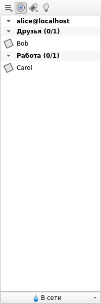
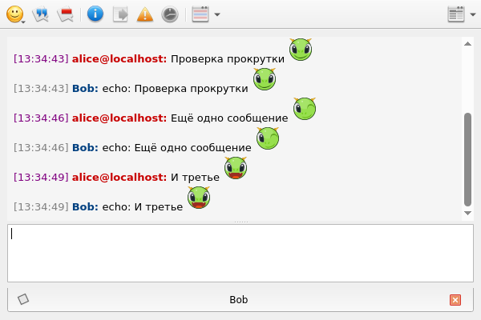
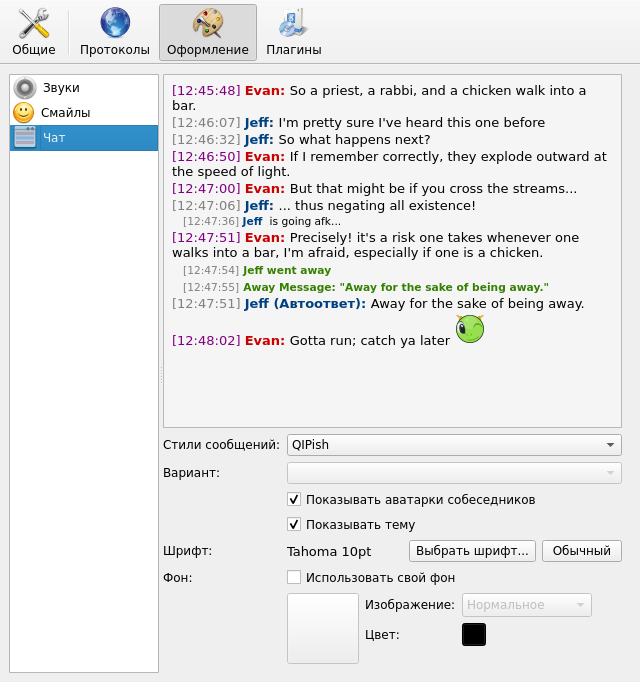

<div align="center">

# qutIM 2026 — XMPP · Qt 6

**Классический модульный мессенджер qutIM, возвращённый к жизни на Qt 6.**
Только Jabber/XMPP, без мёртвых протоколов и мёртвых модулей Qt.


-fcc624?logo=linux&logoColor=black)


[Возможности](#возможности) ·
[Скриншоты](#скриншоты) ·
[Установка](#установка-из-пакета) ·
[Сборка](#сборка) ·
[Профили и история](#профили-и-история) ·
[Что изменилось](#что-изменилось-по-сравнению-с-апстримом) ·
[English](#english)

</div>

---

## О проекте

[qutIM](https://github.com/euroelessar/qutim) — модульный мессенджер на Qt: всё, от списка
контактов до окна чата, сделано отдельными плагинами. Апстрим замер в 2023 году и
собирался только на Qt ≤ 5.5: он держался за QtWebKit, Qt Quick 1, QtScript и Phonon,
которые давно удалены из Qt.

Этот форк переносит qutIM на **Qt 6** и оставляет один протокол — **XMPP** (библиотека
[jreen](src/3rdparty/jreen) вкопирована в дерево). Задача — привычный qutIM с группами,
Adium-темами, OTR и треем, который собирается и работает на современном Linux
(основная цель — XFCE, также GNOME на Wayland).

## Возможности

| | |
|---|---|
| 💬 **Чат** | Вкладки или отдельные окна, Adium-стили сообщений (8 в комплекте, сторонние ставятся в `share/webkitstyle`) на **Qt WebEngine**, лёгкий текстовый вид на выбор, смайлы (Default, Breeze, Konqi), цитирование, поиск выделенного, отметки доставки (XEP-0184) |
| 👥 **Ростер** | Группы ростера как раскрывающиеся списки, учётные записи, метаконтакты, сортировка по статусу или активности, поиск |
| 🏠 **Конференции** | MUC: вход, закладки, список участников, топик (редактируется прямо в окне чата) |
| 🔒 **Безопасность** | OTR-шифрование (libotr 4), хранение паролей в системном keychain (QtKeychain) или зашифрованном профиле (AES) |
| 🔔 **Уведомления** | Системные (freedesktop D-Bus), всплывающие окна Kinetic Popups, звуковые темы через Qt Multimedia, иконка в трее |
| 🌐 **Сеть** | Автопереподключение после потери связи (`QNetworkInformation`), TCP keepalive, прокси |
| ⏱ **Автостатус** | «Отошёл»/«Недоступен» по бездействию: X11 (xcb-screensaver) и Wayland (D-Bus) |
| 🧩 **Плагины** | Антиспам, автоответчик, подсветка, превью ссылок, массовая рассылка, напоминания о днях рождения, «сейчас играет» (MPRIS), проверка орфографии (Hunspell/Aspell), формулы, журнал и др. — всего 80 плагинов |
| 🌍 **Языки** | 17 переводов, включая русский, украинский и белорусский; язык системы или выбранный вручную |

## Скриншоты

<table>
<tr>
<td align="center"><br><sub>Ростер с группами</sub></td>
<td align="center"><br><sub>Чат: Adium-стиль QIPish на Qt WebEngine</sub></td>
</tr>
<tr>
<td colspan="2" align="center"><br><sub>«Оформление → Чат»: стиль, вариант, шрифт, фон и живое превью</sub></td>
</tr>
</table>

## Установка из пакета

Готовый `.deb` для Debian testing (forky) / amd64 — на странице
[Releases](https://github.com/wowshok/qutim_2026_fork_xmpp_qt6/releases):

```sh
sudo apt install ./qutim_*_amd64.deb
```

`apt` сам доставит зависимости (Qt 6, Qt WebEngine, QML-модули, libotr, QCA, QtKeychain…).
Пакет собран на Qt 6.11 и рассчитан на дистрибутивы с такой же или более новой версией Qt.

## Сборка

Debian 13+/Ubuntu 24.04+:

```sh
sudo apt install g++ cmake ninja-build pkgconf \
    qt6-base-dev qt6-declarative-dev qt6-multimedia-dev qt6-webengine-dev \
    qt6-tools-dev qt6-l10n-tools qt6-svg-plugins \
    qml6-module-qtquick-controls qml6-module-qtquick-layouts qml6-module-qtquick-window \
    libqca-qt6-dev qtkeychain-qt6-dev libgsasl-dev zlib1g-dev \
    libotr5-dev libhunspell-dev libaspell-dev libxcb-screensaver0-dev
```

```sh
git clone https://github.com/wowshok/qutim_2026_fork_xmpp_qt6.git
cd qutim_2026_fork_xmpp_qt6
git submodule update --init artwork
cmake -S . -B build -G Ninja -DCMAKE_BUILD_TYPE=RelWithDebInfo
cmake --build build
./build/bin/qutim
```

Каталог сборки повторяет установленную раскладку, поэтому qutIM запускается прямо из него.
`cmake --install build` ставит в систему (по умолчанию в `/usr/local`).

Свой `.deb` с зависимостями, вычисленными `dpkg-shlibdeps`:

```sh
cmake -S . -B build-release -G Ninja -DCMAKE_BUILD_TYPE=Release -DCMAKE_INSTALL_PREFIX=/usr
cmake --build build-release --target package
```

> **Мало памяти?** Qt WebEngine тяжёлый: на машине с 2 ГБ собирайте в один-два потока
> (`cmake --build build -j2`). В работе веб-вид чата добавляет примерно 250 МБ (процессы
> Chromium); если это много — «Плагины → Выбор сервисов → ChatViewFactory → Text view».

## Профили и история

- Профиль лежит там же, где у qutIM 0.3/0.4: `~/.config/qutim`
  (`profiles/profiles.json`, конфиги в JSON, история в `history/`).
- Формат истории не менялся: `history/jabber.<учётка>/<контакт>.<ГГГГММ>.json`,
  тот же парсер JSON, UTF-8.
- Профили qutIM 0.2 (миграция `migration02x03`) и учётки других протоколов
  (ICQ, Mail.ru, VK, IRC…) не поддерживаются.

## Что изменилось по сравнению с апстримом

- **Qt 6**: QStringRef → QStringView, QRegExp → QRegularExpression, QTextCodec убран,
  сигналы/слоты проверены против реальных сигнатур, порядок запуска сервисов
  больше не зависит от случайного порядка QHash.
- **Qt Quick 1 → Qt Quick Controls 2**, страницы настроек на QML через QQuickWidget.
- **QtWebKit → Qt WebEngine** для Adium-стилей: мост `client` через QWebChannel,
  совместимость старых стилей (`body.scrollTop`, регистр путей), открытие ссылок в браузере.
- **Phonon → Qt Multimedia**, QtScript-биндинги удалены.
- **Сборка на CMake** вместо qbs, переводы `.po → .qm` при сборке, переводы и jreen — в дереве.
- Исправлены старые баги: отметки доставки, падение диалога конференций, повторные
  уведомления OTR, переподключение после обрыва связи, сохранение статуса при выходе и др.

Подробный план и ход переноса — в [porting.md](porting.md), история — в журнале коммитов.

## Ссылки

- Апстрим: https://github.com/euroelessar/qutim
- Архивные релизы апстрима: https://github.com/euroelessar/qutim/releases/tag/archival_release
- ~~qutim.org~~, ~~wiki.qutim.org~~ — сайты проекта закрыты.

## Лицензия

GPL v3 или новее — см. [GPL](GPL) и [COPYING](COPYING). Оформление (иконки, звуки) — CC BY-SA, см. [CCBYSA](CCBYSA).

---

## English

**qutIM 2026** is a revival of the modular [qutIM](https://github.com/euroelessar/qutim)
instant messenger, ported to **Qt 6** and trimmed down to **XMPP/Jabber** only.
Upstream stopped at Qt ≤ 5.5 because it depended on QtWebKit, Qt Quick 1, QtScript and
Phonon; this fork replaces them with Qt WebEngine, Qt Quick Controls 2 and Qt Multimedia
and builds with CMake.

Features: roster groups, metacontacts, tabbed chats with Adium message styles (Qt WebEngine)
or a light text view, MUC with bookmarks and topics, OTR, delivery receipts, system
keychain, freedesktop notifications, tray icon, idle detection on X11 and Wayland,
automatic reconnect, spell checking, 17 translations and about 80 plugins.

Build instructions are [above](#сборка) (the commands are the same in any language).
Profiles and history stay compatible with qutIM 0.3/0.4 (`~/.config/qutim`).
See [porting.md](porting.md) for the porting log.
